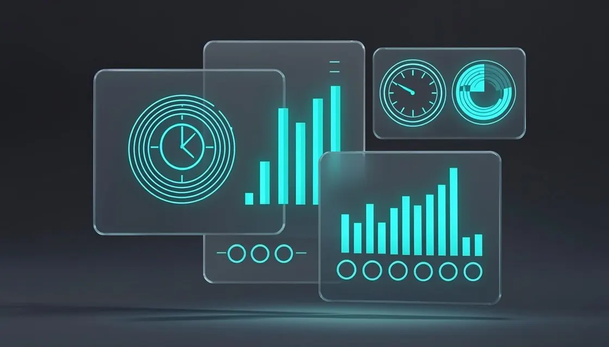

<!-- ──────────────────────────────────────────────────────────────────────
     CheginiSoroush/CheginiSoroush  ·  this repo is special:
     it is the source of imsoroush.ir AND its README.md renders
     on the GitHub profile page.
────────────────────────────────────────────────────────────────────── -->

<div align="center">



<br/><br/>

<a href="https://imsoroush.ir"></a>
<a href="mailto:imsoroushchegini@gmail.com"></a>
<a href="https://github.com/CheginiSoroush"></a>
<a href="https://github.com/CheginiSoroush/CheginiSoroush/actions/workflows/deploy.yml"></a>

<br/><br/>

<a href="https://imsoroush.ir"></a>

</div>

## 🌌 About · درباره من

**I'm Soroush Chegini** — a software developer who ships *real tools*, not tutorials:
a self-updating Ubuntu CLI with **510 automated tests**, a serverless proxy panel running
on **Cloudflare Workers**, gamified Obsidian vaults, interactive books and cinematic
**Three.js** scenes. Everything I make lands on [imsoroush.ir](https://imsoroush.ir) —
**50+ projects** and counting.

> **من سروش چگینی‌ام** — توسعه‌دهنده‌ای که ابزارهای واقعی می‌سازد: خط فرمانِ اوبونتو با بیش
> از ۵۰۰ تست خودکار، پنل پروکسی سِرورلس روی Cloudflare Workers، والپ‌های گیمیفای‌شدهٔ
> Obsidian و صحنه‌های سه‌بعدی با Three.js. هرچه می‌سازم سر از
> [imsoroush.ir](https://imsoroush.ir) درمی‌آورد — الان **بیش از ۵۰ پروژه** و همچنان در حال ساخت.

<br/>

<div align="center">
  <a href="https://imsoroush.ir">
    
  </a>
  <br/><sub>▲ my bilingual (EN/FA) home on the web — click to visit</sub>
</div>

---

## 🚀 Featured projects · پروژه‌های شاخص

<table>
  <tr>
    <td width="33.3%" align="center" valign="top">
      <a href="https://cheginisoroush.github.io/ubuntu-optimizer/">
        
      </a>
      <br/><b>🐧 Ubuntu Optimizer</b><br/>
      <sub>بَش CLI خودبه‌روزشونده · ۲۳ ابزار · ۵۱۰ تست</sub><br/>
      <a href="https://github.com/CheginiSoroush/ubuntu-optimizer">🔗 Repo</a> · <a href="https://cheginisoroush.github.io/ubuntu-optimizer/">🌐 Live</a>
    </td>
    <td width="33.3%" align="center" valign="top">
      <a href="https://cheginisoroush.github.io/flash-panel/">
        
      </a>
      <br/><b>⚡ Flash Panel</b><br/>
      <sub>پنل VLESS/Trojan سِرورلس روی Workers</sub><br/>
      <a href="https://github.com/CheginiSoroush/flash-panel">🔗 Repo</a> · <a href="https://cheginisoroush.github.io/flash-panel/">🌐 Live</a>
    </td>
    <td width="33.3%" align="center" valign="top">
      <a href="https://cheginisoroush.github.io/obsidian-project-quest/">
        
      </a>
      <br/><b>🦉 Obsidian Project Quest</b><br/>
      <sub>پروژه‌هات رو بازی کن · XP، استریک، دشبورد</sub><br/>
      <a href="https://github.com/CheginiSoroush/obsidian-project-quest">🔗 Repo</a> · <a href="https://cheginisoroush.github.io/obsidian-project-quest/">🌐 Live</a>
    </td>
  </tr>
  <tr>
    <td width="33.3%" align="center" valign="top">
      <a href="https://imsoroush.ir">
        
      </a>
      <br/><b>🪐 Cinematic Solar System</b><br/>
      <sub>منظومهٔ شمسی سینمایی با Three.js</sub><br/>
      <a href="https://imsoroush.ir">✨ On the site</a>
    </td>
    <td width="33.3%" align="center" valign="top">
      <a href="https://imsoroush.ir">
        
      </a>
      <br/><b>🌌 Aurora VPN Landing</b><br/>
      <sub>لندینگ مدرن با انیمیشن‌های aurora</sub><br/>
      <a href="https://imsoroush.ir">✨ On the site</a>
    </td>
    <td width="33.3%" align="center" valign="top">
      <a href="https://imsoroush.ir">
        
      </a>
      <br/><b>📖 Atomic Habits — Interactive</b><br/>
      <sub>کتاب عادت‌های اتمی، تعاملی و فارسی</sub><br/>
      <a href="https://imsoroush.ir">✨ On the site</a>
    </td>
  </tr>
</table>

<div align="center">

**➡️ 50+ more experiments live at [imsoroush.ir](https://imsoroush.ir) · بیش از ۵۰ پروژهٔ دیگر**

</div>

---

## 🧰 Tech stack · تکنولوژی

<div align="center">

<a href="https://skillicons.dev">
  
</a>

<br/>


</div>

---

## 📊 GitHub stats · آمار

<div align="center">

&nbsp;&nbsp;&nbsp;

<br/><br/>


</div>

---

## 🌱 Currently · الان روی چی کار می‌کنم

- 🔭 **Building** — edge telemetry for Flash Panel + new Telegram bots
- 🌱 **Learning** — WebGL shaders & edge-computing patterns
- ✍️ **Writing** — habits, productivity & Linux (فارسی)
- 💬 **Ask me about** — Bash, Telegram bots, Cloudflare Workers, Obsidian

## ✍️ Writing · نوشته‌ها

I write in **Persian** about habits, productivity, Linux and building in public —
all of it lives on [imsoroush.ir](https://imsoroush.ir).
> دربارهٔ عادت‌ها، بهره‌وری، لینوکس و ساختن به زبان فارسی می‌نویسم — همه در
> [imsoroush.ir](https://imsoroush.ir).

## 🤝 Contact · ارتباط

<div align="center">

Got an idea, a bug, or just want to say سلام؟ →
**[imsoroushchegini@gmail.com](mailto:imsoroushchegini@gmail.com)**

</div>

---

<details>
<summary><b>⚙️ Run this site locally · اجرای محلی سایت</b></summary>
<br/>

This repository **is** the source of [imsoroush.ir](https://imsoroush.ir).

```bash
bun install

# environment (server-side only)
#   DATABASE_URL   — file:./db/custom.db
#   GITHUB_TOKEN   — optional, raises GitHub API rate limits
#   ADMIN_KEY      — admin panel key (set your own secret)

bun run db:push     # create the local database
bun run dev         # http://localhost:3000
```

| Command                | What it does                         |
| ---------------------- | ------------------------------------ |
| `bun run build`        | Production build (standalone output) |
| `bun run start`        | Run the standalone server            |
| `bun run lint`         | ESLint                               |
| `bun run typecheck`    | TypeScript check (`tsc --noEmit`)    |
| `bun run db:push`      | Push the Prisma schema to the DB     |
| `bun run db:generate`  | Generate the Prisma client           |

Deploy tip: `deploy/ci-deploy.sh` runs **lint + typecheck** as quality gates before every
Cloudflare Workers deployment — keep both green.

</details>

<div align="center">
  <br/>
  
  <br/>
  <sub>© Soroush Chegini · built with Next.js · deployed on Cloudflare Workers · <b>ساخته‌شده با ♥ در ایران</b></sub>
</div>
